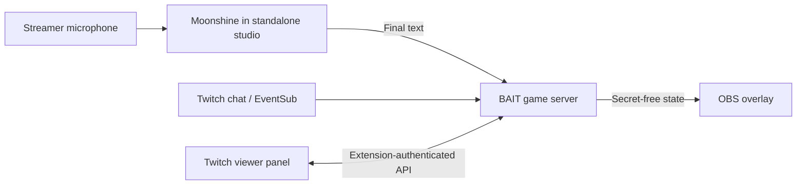

# BAIT: next steps, Twitch setup and Extension review

Checked 25 October 2026 against the game source and current official Twitch documentation. This is the current entry point; earlier planning was split across the documents linked below. No account registration, live-game deployment or Extension submission was performed while preparing it.

**Latest setup plan:** [baited v0.0.1 branding and first-test guide](baited-v0.0.1-plan.md). The owner chose **baited** as the new name; visual production and integration are pending. Twitch validated the existing OAuth app credentials through Proton, and both test accounts are resolved: `komediruzecki7` (501062940) and `yahwehwastaken` (566058624). Reuse the existing application and Extension; do not register duplicates. The new guide supersedes the older account-creation instructions below where an object already exists.

## Where we are

| Part | Current state |
| --- | --- |
| Landing | Released at [bait.maff.app](https://bait.maff.app/) and [dev.bait.maff.app](https://dev.bait.maff.app/), from private `disjoint-colliders/packages/bait`, tag `bait-v1.0.0`. Its replay is scripted. |
| Game | Private [Komediruzecki/bait](https://github.com/Komediruzecki/bait), separate Node server, studio, secret viewer room and OBS overlay. Not deployed for remote play. |
| Gameplay | 72 target/clue cards; difficulty, skip votes, three-word missions, private guesses, hint awards and win reversal already exist. |
| Art and audio | 18 illustrated targets and six opt-in sound cues. Illustrations are not separate action-card mechanics. |
| Speech | Local Moonshine is the default. A proposed catch needs broadcaster confirmation. Deepgram is optional; ElevenLabs has no adapter. |
| Evidence | Synthetic speech and OBS-load checks exist. A physical-microphone round with real Twitch chat, the actual OBS overlay and a remote viewer still needs to pass. |
| Native Extension | Not implemented or submitted. The deployed landing and OBS browser source are not an Extension. |

## V2 design review

Opus completed the **Dealt In** direction on 25 October 2026: a violet broadcast stage, charcoal cards, a staged 32-second round called **The Spicy Mountain**, and a local hint-writing interaction. The [v2 review index](v2/README.md) links the detailed [landing plan](v2/landing-plan.md), [hero storyboard](v2/hero-storyboard.md) and [gameplay/card expansion plan](v2/gameplay-plan.md).

The mockup is isolated from the released landing and game. Review its layout, motion and phone behavior before choosing integration or release. Opus calls for this work use the `irch` account, request Max effort and allow 45 minutes per pass. The plans do not authorize deployment or gameplay expansion.

The content proposal targets 100 complete cards (50 illustrated and 50 type-led), then roughly 1,000 reviewed words. The existing 18 illustrations stay intact. Authored openers, moment stamps and card reactions come before the larger game modes; Six-word showdown is the first proposed gameplay experiment. All remain behind the real-round acceptance milestone below.

## The next working milestone

Record one complete round: Paolo sees the secret, posts a real hint in Twitch chat, the streamer says the target, Moonshine proposes the catch, the streamer confirms it, and the OBS recording shows one result without exposing the secret early.

| Order | Work | Done when |
| --- | --- | --- |
| 1 | Repair the Moonshine rehearsal setup | `scripts/rehearse-local.mjs` no longer demands a Deepgram key in Moonshine mode; its reference-only template explicitly selects Moonshine. Missing Twitch/encryption credentials still fail clearly. |
| 2 | Connect the existing Twitch application | Intended channel signs in and a second account's actual chat reaches the game. |
| 3 | Test the real microphone | Both teammates test natural speech, similar words, game audio, near-buzzer speech, confirm/reject and reconnect. Keep confirmation mandatory. |
| 4 | Check OBS Browser Source and record locally | Actual BAIT overlay, camera/game and audio appear correctly. No duplicate sound or captured viewer page. |
| 5 | Host the live game for remote viewers | One persistent Node process, disk, HTTPS, working SSE/WebSockets, exact OAuth callback and restart checks. Choose host, game hostname and operating cost first. |
| 6 | Rehearse from a second device/network | Viewer joining, complete round, pause/recovery and correction work without developer assistance. |
| 7 | Prepare the Extension and submission packet | Follow the separate paths below. Do not make review approval a dependency of the real-game demonstration. |

**Known setup mismatch:** the current `rehearsal:local` helper and both local vault templates still require `DEEPGRAM_API_KEY`. Supplying a dummy key would hide the problem. Fix the helper and template before using that workflow for Moonshine. The keyless local demo can already exercise Moonshine, but its simulated chat is not proof of Twitch integration.

The saved synthetic comparison found 4 of 6 targets and one false target candidate among six negative sentences in both runs. These small fixture results do not establish human recognition accuracy. The installed SDK's confidence is a constant placeholder. See [Moonshine behavior](moonshine.md) and [the measured rehearsal](moonshine-rehearsal.md). The last OBS inspection lacked Browser Source; recheck **Sources → + → Browser** in the running installation.

## Account setup: start here

1. Use broadcaster `komediruzecki7`. Sign into the [Twitch Developer Console](https://dev.twitch.tv/console/apps), verify the account email and enable 2FA.
2. Under **Applications**, open the existing application. Confirm its **Confidential** client type and exact local callback `http://localhost:3000/auth/twitch/callback`. The server handles the secret and authorization-code exchange. [Official app registration](https://dev.twitch.tv/docs/authentication/register-app/).
3. The OAuth ID/secret already resolve from Proton item `dev / tw-bait-ids`. Still verify or securely provision the persistent token-encryption key and separate Extension shared secret. Share only field names or `pass://` references. No Twitch password, stream key or speech-provider key is needed by the app for Moonshine.
4. After the rehearsal helper is corrected, connect the intended broadcaster and authorize the existing `user:read:chat` scope. BAIT's code uses EventSub to read that channel's chat. Use `localhost:3000` consistently for this callback.
5. In the studio, load Moonshine, enable the microphone and use headphones. The model runs in the standalone studio. Audio stays on that computer; final text goes to the game server for matching without being persisted.
6. In OBS, add the **OBS overlay URL** from Stream setup as a 1920×1080 Browser Source. Keep the secret viewer page and studio out of the captured scene. Record first; verify the sound is captured once. The overlay itself stays silent.

The earlier [Twitch/Deepgram/OBS guide](twitch-deepgram-obs-setup.md) contains expanded OAuth and OBS steps, but its provider recommendation and launcher instructions predate Moonshine. It is not the current default workflow.

## Do we need a Twitch organization?

One account can own the first Extension. Shared management in Twitch's console uses an organization; it need not be an incorporated company. GitHub collaboration can continue while approval is pending.

Open [the console](https://dev.twitch.tv/console) → account dropdown → **Create Organization**. Enter the real Irchiinnuss details, Developer type, website, matching-domain contact email, team size and location. Select Extensions; do not claim an unrelated game. Both members need verified email and 2FA. Approval typically takes two business weeks. After approval, use **Manage Members** to add Paolo as Developer. Before changing ownership, verify Twitch's supported transfer path for the existing Extension; do not recreate it. [Twitch organization guide](https://dev.twitch.tv/docs/companies/).

## Make BAIT a native Twitch Extension

Recommended first version: a small **viewer panel** containing the secret card, forbidden clues, round state and result. The [v0.0.1 plan](baited-v0.0.1-plan.md) keeps existing `!skip` chat commands and defers a new panel voting control. Keep Moonshine and the microphone in the standalone broadcaster studio. OBS displays the existing secret-free overlay. Viewers should not download the speech model.

This panel and its authentication are planned work. The current viewer URL and studio cookies cannot simply be moved into a Twitch iframe.

Implementation checklist:

- Build viewer and broadcaster configuration entry points. Start with the existing card UI, sized for a panel; keep the landing's large animation/gallery out of the first load.
- Load Twitch's Extension Helper in every entry point. Use `onAuthorized` and validate the supplied JWT on the server, including signature, expiry, channel and role. Extension credentials are separate from the ordinary OAuth app's credentials.
- Map each authorized channel to its BAIT room. Keep viewer actions separate from broadcaster controls. Never trust a client-provided channel or role; never ship secrets in the frontend.
- Expose only the required HTTPS API/WSS endpoints with explicit origins and network allowlists. Preserve the standalone studio's existing protection. Twitch's CDN hosts the frontend; our host still runs the game backend.
- Test renewal, expired credentials, wrong-channel requests, disconnects and installation/configuration. The active secret belongs only in the viewer projection. As with the current companion page, secrecy depends on the streamer choosing not to look at the viewer view.

[Twitch building guide](https://dev.twitch.tv/docs/extensions/building/). Mobile support requires testing inside the Twitch mobile app, not only a narrow desktop browser. Follow the [Extension policies](https://dev.twitch.tv/docs/extensions/guidelines-and-policies/) for audio controls, assets, external connections and any user-generated content.

## Create, test and submit the Extension

1. In the intended owner's [Extensions console](https://dev.twitch.tv/console/extensions), open the existing Extension and confirm **Panel** and version `0.0.1`. The planned display name is **baited**. This version is independent of the landing's `bait-v1.0.0` tag. [Creation tutorial](https://dev.twitch.tv/docs/tutorials/extension-101-tutorial-series/create-extension/).
2. **Local Test:** configure the HTTPS testing base URI and viewer/config paths. Install and activate on the test channel. Use numeric IDs `501062940,566058624` in the testing-account allowlist, not usernames.
3. Upload the built frontend ZIP with files at its root, then enter **Hosted Test**. Keep Node code, credentials, local data and speech models out of that ZIP. Test against the reachable game backend.
4. Complete the listing, author/contact fields, privacy and terms URLs, logo, discovery image and screenshots. Supply the review channel and walkthrough. Submit for **Review**.
5. Resolve requested changes. Once approved, choose **Release**. Twitch estimates 8–14 days for review, sometimes longer. A website tag does not submit or release an Extension. [Lifecycle and exact submission fields](https://dev.twitch.tv/docs/extensions/life-cycle/).

The testing-account allowlist grants prerelease testing access. The streamer allowlist restricts installation; do not confuse the two. For review, explain installation, external studio setup, microphone consent, one successful round and confirmation/rejection. Include reviewer availability within 09:00–17:00 Pacific because the full BAIT loop needs an active operator. Keep the backend available; continuous broadcasting throughout the queue is not required. [Review walkthrough guidance](https://dev.twitch.tv/docs/extensions/submission-best-practices/).

## Creative follow-ups, in order

These are proposals, not shipped features. Demonstrate the existing missions, private guess and hint awards before adding more systems.

| Idea | What changes in play | Effort / next proof |
| --- | --- | --- |
| Six-word showdown | Award-eligible hints have at most six words. Longer hints do not punish the community or delete Twitch messages. | Small. Test three rounds; keep only if understood without coaching. |
| Themed decks | Food, creatures, fantasy and everyday objects give streams a recognizable theme. Add art to selected words among the 54 currently without bespoke illustrations. | Small to medium. Speech-test targets before producing more art; do not equate art count with new mechanics. |
| Reveal sequence | After a confirmed catch, show the chosen clean hint, flip the card and play one opt-in cue. Give the trap a readable payoff. | Medium. Never expose the target early or imply automatic attribution. |
| Audience chooses the next constraint | A timed pre-round vote selects Classic or Six words. | Medium. One latest vote per viewer, fixed close time and a safe no-vote default. |
| Bank or bait | After mission word two, chat banks a small bonus or risks it on word three. | Medium to large. Separate bonus accounting, ties and win-reversal behavior need testing. |
| Pass the mic | Two streamers alternate responsibility under one clock. | Large. Separate microphone ownership, consent and reconnection; save for after the first release. |

The saved [tabletop plan](tabletop-options.md) gives the exact Six-word, Bank or bait and Pass the mic proposals. The reveal sequence and themed-deck priorities above are follow-up suggestions. Keep sound opt-in and avoid simultaneous playback from the studio and OBS overlay.

## Devpost is a separate submission

The current rules allow Twitch chat/overlay/API integrations; native Extension approval is not required. Two eligible individuals can enter as a team with one representative; legal organizations cannot enter. Twitch-console team management does not by itself settle project ownership or entrant eligibility. Confirm the submitted work belongs to the eligible entrants, particularly if using a company brand. [Official rules](https://twitchcon-codex.devpost.com/rules).

Deadline: **2 November 2026, 23:00 Zagreb**. Prepare a public YouTube demo under three minutes showing working Twitch play and Codex use, the main Codex session ID, complete source/assets/run instructions, and the English description. Private GitHub is allowed with the specified judge access. Check the exact recipient in the rules before inviting anyone. Target team review on 1 November. [Official requirements](https://twitchcon-codex.devpost.com/rules).

Working documents: [submission draft](../devpost-submission.md), [team checklist](team-and-release-checklist.md), [demo script](demo-script.md), [judge walkthrough](judge-walkthrough.md), [game-hosting runbook](deployment-runbook.md).

Suggested split: maff handles runtime/accounts/hosting; Paolo tests as the independent viewer and reviews rules, art and the demo edit. Both review the final entry.

## What the owner needs to provide next

- Extension shared-secret field/reference; the OAuth fields and both test identities have been verified. The game also needs a persistent token-encryption key, provisioned securely if none exists.
- Confirm the existing Extension's owner, version state and display type. An Irchiinnuss organization can follow if both teammates need console administration.
- Which microphone to use and whether OBS currently offers Browser Source.
- A hosting/domain/budget decision for the live game after the local round passes. The existing landing deployment does not supply that runtime.
