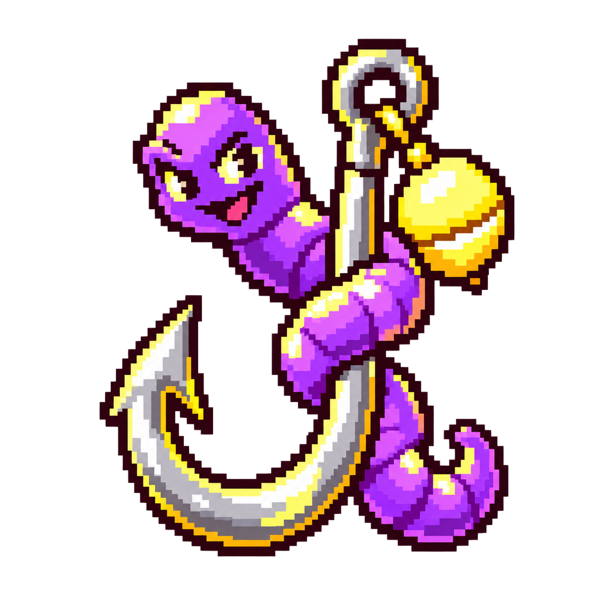
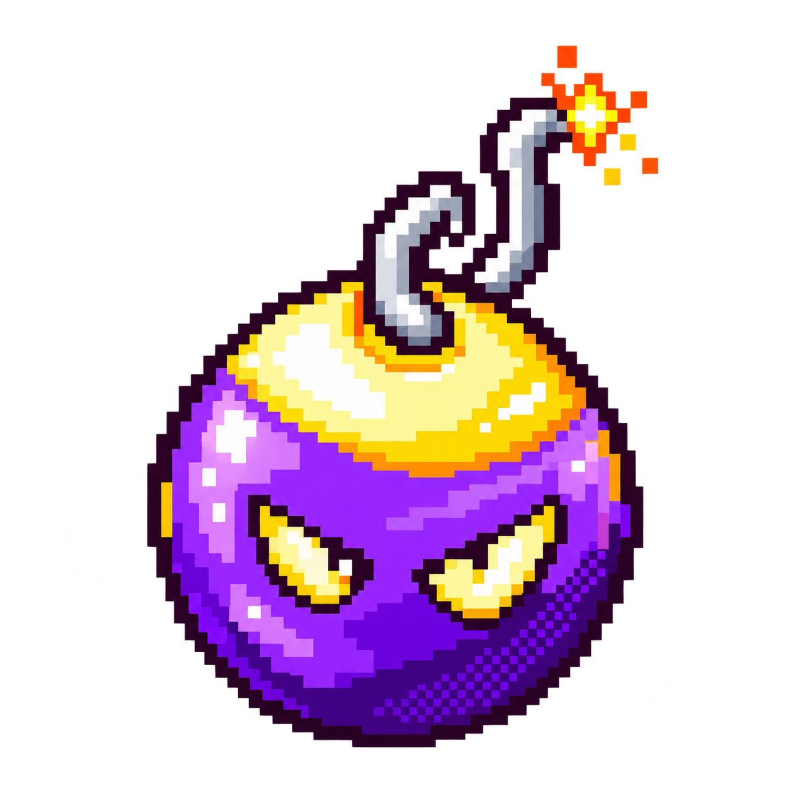
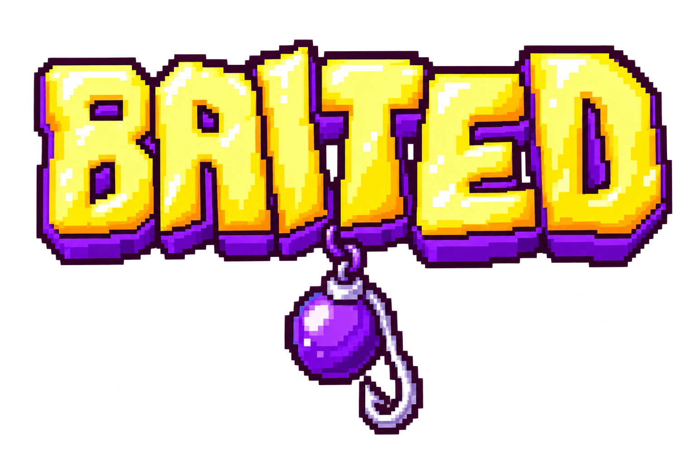

# BAIT illustration candidates

Three card-art directions generated with built-in ChatGPT image generation on 31 October 2026. The owner selected A (Lure) for the recording BAIT card. B and C remain saved for later use. The main logo stays unchanged.

| A: Lure | B: Bomb | C: Logo collectible |
| --- | --- | --- |
|  |  |  |
| Selected for the BAIT card. | A compact finale emblem. | A branded reward or end-card treatment. |

The lure and bomb fit the existing pixel-art deck. Use `object-fit: contain` within the current illustration bounds when a candidate is selected; do not stretch or crop them. The logo candidate is wider and retains a soft violet glow, so it needs review against the final card surface before integration.

The images contain no game rules, target labels or timer UI. Those stay as accessible live text in the card renderer. The main Baited wordmark remains unchanged.

See [exact prompts](prompts.json) for references and generation instructions, and [manifest](manifest.json) for dimensions, hashes and transparency measurements. Generated originals were copied unchanged. A separate background-removal attempt on the logo was preserved in the task's artifact run; it did not fully remove the glow and is not the preferred candidate.
