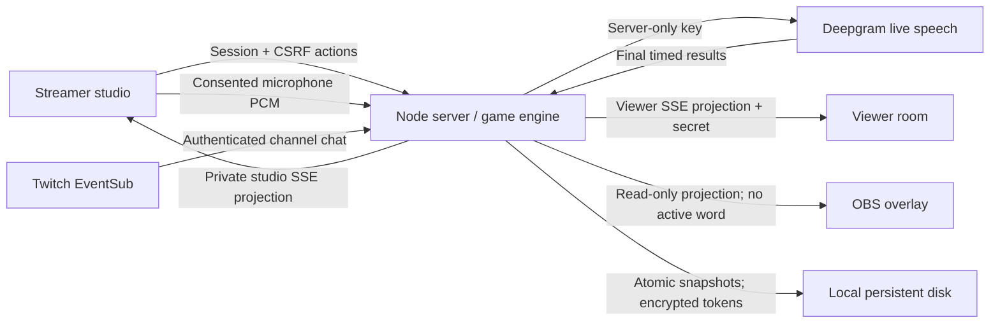

# Architecture

> This document describes the original Deepgram path. For the current default, read [Moonshine's architecture and confirmation rules](moonshine.md): audio stays in a browser worker and authenticated final-text messages go to the server. The Deepgram-only diagram and statement below that browser JSON cannot submit transcripts do not describe Moonshine. See [the current master plan](master-plan.md) for the Extension work still required.

## Server owns the round

`Game` is a synchronous state machine. All deadlines, words, scores and votes live on the server. Client clocks only render countdowns and are corrected by server timestamps. JavaScript processes each mutation in order; a winning transition leaves `active` immediately, so concurrent final results cannot create extra wins.

Phases normally follow `idle → active ↔ paused → cooldown → idle`. At the deadline, a live Twitch round with a listening microphone enters `settling` for at most 1.5 seconds before escape, allowing a final result for speech completed before the deadline. No new capture is accepted during settling. Demo expiry is immediate. The broadcaster may skip or end a round. Live start, resume and automatic rounds require connected Twitch, configured speech and a valid microphone-owner lease. Settings survive restart; active rounds, current streak and browser sessions do not. This prevents replaying a stale round after a crash. Scores and historical best remain.

A reversal changes the latest result to `overturned` and restores the previous score/streak/best. It does not reopen a word that has been revealed. Round participation remains credited because those viewers joined the round.

## Role boundaries

Every studio request resolves the room from its authenticated server session, never from a supplied room ID. Mutations also require an exact Origin and session CSRF token. The session ID is random, HttpOnly and SameSite Lax; production adds Secure. OAuth has a separate single-use, cookie-bound state nonce and rotates the studio session on success.

Viewer URLs contain a random room ID. Viewer endpoints deliberately return the target. Overlay endpoints require a separate random read key and return an explicit projection without the target or control credentials. Studio endpoints receive the same secret-free projection plus share URLs. No frontend module imports the word bank. Do not log capability URLs, session cookies or OAuth/speech queries at the proxy.

The room owner can open the viewer URL and read the word. Chat can also spoil it. Target spoilers, including disguised spellings such as pengu1n or p e n g u i n, earn no participation credit. Forbidden-clue hints can still count as participation but cannot receive an award. Active hint text stays out of the studio response. After a word is revealed, its retained hints appear only in the authenticated studio for manual award review; public views receive the selected name and totals. BAIT does not moderate or delete messages on Twitch, but it follows its moderators: a deleted message leaves the hint review, and a ban or timeout removes all of that chatter's hints. An award goes with its hint while the ten-minute review is open; after that it stays.

## Twitch and recovery

One EventSub connection per channel uses the owner’s user token. A new connection subscribes to `channel.chat.message` after welcome, then to `channel.chat.message_delete` and `channel.chat.clear_user_messages`. All three need only `user:read:chat`. The two moderation subscriptions are optional: if Twitch refuses them, chat stays connected and hints simply stay until the review closes. Twitch-requested migration carries the subscriptions to the replacement connection. Ordinary reconnect creates a fresh session/subscription. The watchdog, duplicate filter, reconnect backoff and rate-limit reset support are exercised with fixture sockets and HTTP responses.

Refresh requests are shared per owner and rotated tokens are persisted. The current implementation invalidates an in-flight refresh when its owner disconnects so a late response cannot restore removed local credentials. A replacement login supersedes older authorization separately from revocation: a stale refresh or validation response cannot delete the newer login. Invalid/revoked current authorization ends owner sessions. Token encryption uses a unique random IV and AES-256-GCM authentication for every write. The encryption key is supplied from Proton Pass to the host process environment, separate from the state file. A write queue and atomic rename prevent interleaved snapshots. A storage error makes the health endpoint unhealthy and logs a redacted diagnostic.

`TRUSTED_PROXIES` defaults empty and accepts only explicit proxy IPs/CIDRs. Rate limits use the resulting validated client address, not an arbitrary client-supplied forwarded header. The deployment must restrict the backend and configure the real proxy to overwrite forwarding headers. See `deployment-runbook.md`; the source configuration is not proof of correct hosted topology.

## Speech lifetime

The microphone is opt-in. The AudioWorklet is disabled until the provider is ready for an active round. Generation-tagged packets clear partial PCM buffers at round changes and pause/resume. The server binds each speech socket to a session, round ID and epoch, and permits one microphone stream per room. An authenticated CSRF-protected arm request requires a live studio SSE connection and establishes a readiness lease tied to the session and a per-capture UUID. The client renews that lease every ten seconds and it expires after thirty seconds. Renewals cannot create a new lease or revive a disarmed capture, and another studio tab cannot renew the owning capture's lease. Logout, owner-session loss, or loss of readiness disarms and pauses live play. Invalid leases close on state changes.

Only binary PCM is forwarded; JSON from the browser cannot inject a winning transcript. Provider keys exist only on the server. Results must be final and fit the submitted audio duration. The matching word's confidence must reach 0.8, and its timestamps must fit the active epoch and speaking deadline. An unrelated uncertain word does not by itself reject the target. Paused, ended, replayed, future or mismatched results are ignored. During the bounded deadline settlement, the bridge requests a provider final and rejects further capture. The bridge does not buffer recordings. Slow upstreams, more than two seconds without PCM including a missing first frame, and provider errors stop the connection and pause active play instead of silently dropping audio while its clock drifts. Re-enable after an error; normal round transitions preserve mic consent.

The physical microphone stays open while consent is armed so automatic rounds can resume. No audio is sent during idle, pause or cooldown. Disabling, leaving the studio or device removal releases the capture tracks. The transcript is not displayed or stored.

## Limits

- One process and one writable state directory. Do not run multiple replicas against the same file. An eventual clustered version would need shared authoritative state and pub/sub.
- At most 2,000 SSE subscribers per instance. State broadcasts are coalesced to at most 10 per second per room, and slow clients are disconnected. Actual internet fanout at this limit has not been load-tested.
- Up to 10,000 participating chatters per round; a chatter can add activity at most once per three seconds. Skip votes are one per chatter. Up to 1,000 cumulative participant records per room and 100 historical outcomes are retained; chatters with streamer's picks are kept first, and aggregate scores survive history compaction.
- Participation credit records rounds joined by active chatters. Passive lurkers and page opens do not earn points. BAIT cannot determine which hint caused a win. No public client can submit Twitch identity claims.
- The local demo is restricted to a loopback peer in non-production. It is not saved. Reverse proxies count as the peer; never expose a development server through a proxy. Production disables the local demo regardless of the environment flag.
- English, curated single-word targets. Recognition latency and accuracy depend on the provider and audio conditions. No latency benchmark with a real provider has been recorded.
- The Docker image built and passed an isolated non-root production smoke check. HTTPS proxy topology, hosted persistence and live providers have not been deployment-tested. There is no hosted judge URL yet.

## Data and deletion

The state file stores room owner/channel IDs, settings, outcome words and times, bounded participant IDs/names/counts, read-only overlay keys and encrypted OAuth credentials. BAIT does not persist message bodies, audio, transcript text or private guess text. It holds up to 40 eligible and 20 flagged hints in memory during a round and for up to ten minutes after it ends, replacing that review when the next round ends. Each author has at most three eligible hints and one flagged hint in the retained set. Selected award names and counts are persisted. A session lives for 12 hours in server memory. OAuth nonces expire after 10 minutes.

The data deletion route revokes authorization on a best-effort basis, removes the local room and tokens, closes live sockets and ends all owner sessions. Twitch’s own connection settings provide independent revocation. Operators must protect the state directory and supply their contact details for privacy requests when hosting publicly.
