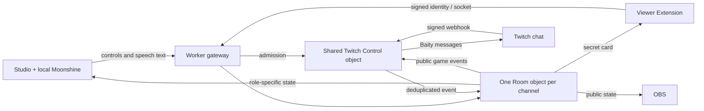

# Baited pilot: architecture and running costs

**Checked 29 October 2026.** USD before tax. The Worker pilot and client adapters are implemented locally. The prepared deployment is disabled, with no public route. This document does not claim a live Twitch acceptance test or measured Cloudflare bill. No paid resources or hosted load tests were activated for this review.

The pilot uses the existing deck, initially allows `komediruzecki7`, `lakeeko` and `yahwehwastaken`, and limits each channel to 100 round participants and 100 concurrent viewer sockets. Channel capacity is configurable up to 10. Custom cards, uploads and scanners are excluded; the pilot configuration does not bind an R2 bucket.

## Who sees the hidden card?

There is **one authoritative card per channel, but a separate delivery to each participating viewer**. The secret card is not baked into the OBS video. Anything baked into that video is the same picture for the streamer and everyone watching.

| Surface | During a live round | Connections to Baited |
|---|---|---|
| OBS Browser Source | Public timer, score and hidden card | Normally one per OBS source; Twitch distributes the resulting video |
| Twitch viewer overlay/panel | Secret word, artwork and off-limits clues | One per loaded Extension instance |
| Broadcaster's own Twitch Extension | Hidden card | One per loaded instance, with a restricted response |
| Streamer Studio | Controls, microphone, chat hints and public state | One controller connection |

Twitch hosts the Extension interface and supplies a signed visitor JWT. Our backend verifies its channel, identity, role and expiry; it does not call Twitch for every card update. Extensions run separately from the video, so a viewer-only overlay does not automatically appear in an OBS recording. [Twitch Extension architecture](https://dev.twitch.tv/docs/extensions/building/), [Extension identity reference](https://dev.twitch.tv/docs/extensions/reference/)

The broadcaster restriction prevents accidental disclosure to the recognized broadcaster account. A streamer can still cheat through another account or a viewer's screenshot. This is an honest-player party game, not cryptographic anti-cheat.

## The implemented architecture

| Responsibility | Where it runs | Why |
|---|---|---|
| Video encoding/distribution | OBS and Twitch | Baited does not process or serve video |
| Speech recognition | Moonshine in Studio's browser | No server GPU or paid speech API |
| Cards, animation, countdown | Browser | The server sends deadlines, not one database read per visual tick |
| Authentication and routing | Worker gateway | Reject invalid host, origin, identity and channel before room access |
| Twitch OAuth, subscription lifecycle and Baity budget | One shared Control Durable Object | Protect credentials and coordinate account-wide limits |
| Card selection, round timing, scoring and decisions | One Room Durable Object per channel | One ordered authority with durable recovery |
| History and replay protection | Bounded SQLite records | Persist decisions and reject duplicates |

**OAuth** authorizes a Twitch account/channel. The **Extension JWT** proves a visitor's role and channel. A short-lived **Studio capability** permits controls; an **OBS capability** permits only the public display. Permission to receive a card does not permit controlling the game. Signed EventSub webhooks carry chat independently of viewer sockets; retries are deduplicated. [Twitch EventSub delivery](https://dev.twitch.tv/docs/eventsub/handling-webhook-events/)

### Legacy Node mode versus this pilot

| Area | Legacy Node mode retained in the app | Implemented edge pilot |
|---|---|---|
| Extension transport | Polls one second after each response | Hibernating WebSocket; no per-second polling |
| Studio/OBS transport | Server-sent events | One room WebSocket, refreshed credentials and bounded reconnects |
| Speech | Local Moonshine, Node adapter | Local Moonshine, authenticated progress/final-text messages bound to controller, lease and round |
| Twitch integration | Node server/chat connection | OAuth, signed EventSub, durable dedupe and shared bot queue |
| Storage | Existing Node persistence | Changed records; stable-ID hints/history plus bounded order records, including legacy checkpoint migration |
| Audience updates | Existing transport behavior | Role-specific projection revisions suppress unchanged viewer/OBS snapshots |

The pilot ZIP selects the edge transport and its configured origin. Uploading an old polling ZIP against the new backend would not provide this behavior. Relevant implementation: `src/index.ts`, `src/control.ts`, `src/room.ts`, `src/state-store.ts`, `../app/client/edge-transport.ts` and `../app/extension/client.js`.

## Work that still happens while playing

WebSockets remove repeated “anything changed?” requests. They do not make an active game free of messages or storage work.

| Operation | Current cadence/path | Cost implications |
|---|---|---|
| Initial viewer connection | Worker → Control admission → Room socket | One Worker request and two DO calls |
| Incoming chat | Worker → Control webhook/dedupe → Room | One Worker request and normally two DO calls per delivery, plus storage |
| Microphone lease renewal | Every 10 seconds while the microphone is enabled; command POST, then state GET | Two Worker requests and four DO calls per renewal; lease/receipt commit and state-read rate-counter write |
| Speech progress | 2,048 samples at 16kHz: about 7.8125 metadata frames/second during capture | Incoming Room WS messages; raw audio stays local |
| Final transcript | When Moonshine completes a line | Room validation and checkpoint; frequency depends on speech |
| Studio/OBS credential renewal | Approximately every four minutes | Bootstrap HTTP request, WS refresh and Control admission check |
| Countdown display | Every visual tick, locally | No request just to advance the displayed clock |

A lease renewal normally leaves the viewer and OBS projections unchanged. `Room.commit()` compares those projections at the same clock value and stores their delivery revisions; `broadcast()` skips sockets already holding that revision. Studio still receives its new revision, and the client also fetches state after the command. The local real-client integration test confirms that an unchanged renewal produces no new viewer or OBS snapshot. A new participant, vote, result or other visible change still triggers audience updates.

At 360 lease renewals/hour, each channel adds **720 Worker requests and 1,440 DO calls/hour**. Sixty microphone-enabled hours add 43,200 Worker requests and 86,400 DO calls per channel. The progress stream adds about 28,125 incoming WS frames/hour, equivalent to 1,406.25 DO request units under the published 20:1 billing ratio. Checkpoints, indexed dedupe, expiry cleanup and alarm operations add storage work; one chat event is not necessarily one billed row write.

## Your existing $5 Workers plan

These are **shared account allowances**, not fresh allowances per Worker or channel. Remaining account usage was not inspected.

| Meter | Monthly Paid inclusion | Overage |
|---|---:|---:|
| Workers plan | $5 minimum, already paid | Usage above inclusions |
| Worker requests | 10 million | $0.30/million |
| Worker CPU | 30 million milliseconds | $0.02/million milliseconds |
| Direct static assets | Free/unlimited | Requests that invoke Worker code use its meter |
| Worker bandwidth | No egress charge | Separate products can differ |

WebSocket establishment counts as a Worker request; established socket messages and outbound Worker subrequests are not additional Worker requests. [Workers pricing](https://developers.cloudflare.com/workers/platform/pricing/)

| Durable Object meter | Monthly Paid inclusion | Overage |
|---|---:|---:|
| Requests | 1 million | $0.15/million |
| Active duration | 400,000 GB-seconds | $12.50/million GB-seconds |
| SQLite rows read | 25 billion | $0.001/million |
| SQLite rows written | 50 million | $1/million |
| SQLite storage | 5 GB-month | $0.20/GB-month |

Incoming WS messages receive a 20:1 request ratio; outgoing WS messages have no request charge. HTTP handoffs and alarms count. Eligible idle hibernation avoids duration charges; active duration uses 128MB per object. Excess compute usage rounds up to its billing unit. [Durable Objects pricing](https://developers.cloudflare.com/durable-objects/platform/pricing/)

The pilot has observability disabled and no Containers, D1, Queues, Workers AI, upload scanner or R2 workload. That avoids adding services the built-in-deck pilot does not need. Its CPU limit and admission controls reduce exposure; they do not impose a hard monthly spending ceiling.

## Illustrative monthly traffic and costs

Assume **100 viewers per channel, two hours/day for 30 days**, one initial viewer connection per day, one chat message/person/minute, microphone enabled throughout, and continuous capture for the progress-message calculation. Assume all account inclusions remain available. These are arithmetic scenarios, not usage measurements.

| Streamers | Viewers | Old one-second polls/hour, approximately | New initial viewer connections/day |
|---:|---:|---:|---:|
| 3 | 300 | 1,080,000 | 300 |
| 5 | 500 | 1,800,000 | 500 |
| 10 | 1,000 | 3,600,000 | 1,000 |

The old delay begins after each response, so its actual steady rate is slightly lower. The pilot removes that loop.

| Streamers | Chat events/month | Worker requests: chat + viewer joins + mic renewals | DO request units for those paths + speech progress | Rounded DO request overage for these items |
|---:|---:|---:|---:|---:|
| 3 | 1,080,000 | 1,218,600 | 2,690,325 | $0.30 |
| 5 | 1,800,000 | 2,031,000 | 4,483,875 | $0.60 |
| 10 | 3,600,000 | 4,062,000 | 8,967,750 | $1.20 |

Example for ten channels: 3.6M chat + 30k viewer joins + 432k microphone HTTP requests = 4.062M Worker requests. Each of those HTTP paths touches Control and Room; 16.875M speech-progress frames add 843,750 DO request units.

**Those prices cover selected request meters, not the complete bill.** For ten channels, renewing one Studio and one OBS credential about 15 times/hour adds roughly 18,000 Worker requests and 36,900 DO request units/month, nudging the illustrated DO request charge to $1.35. Viewer JWT renewals, other controls, final transcripts, bot events, alarms, retries, page loads, CPU and storage are additional.

Duration remains modest in this scenario even if every room and the shared Control object stay active for all 60 hours:

`(10 rooms + 1 Control) × 60 × 3,600 × 0.128 = 304,128 GB-s`

That is below the 400,000 inclusion. Holding all eleven objects awake 24/7 for 30 days instead would use 3,649,536 GB-s and add $50 in rounded duration overage. The pilot uses hibernation and disconnects idle chat after the configured Studio inactivity timeout (15 minutes by default); provider subscription deletion is retried until confirmed.

Storage is the remaining important uncertainty. At 3.6M chat events, an illustrative five billed row writes/event is 18M writes; twenty is 72M. Those are not measured counts. Stable-ID storage removes unnecessary list shifting, but receipt indexes, deletion, Control inbox processing and checkpoint metadata still count. The pilot's bounded data and existing card assets do not require a large database; a real invoice estimate still needs measured row/CPU counters and remaining account allowances.

## Baity: a speed limit, not a wallet

One bot post to a channel is one send, even if 100,000 people read it. Twitch documents rate limits, not a per-message price or paid quota upgrade.

| Twitch account/destination | Published send limit |
|---|---|
| Ordinary account | 20 messages/30 seconds across that account |
| Broadcaster/moderator/VIP destinations | Higher 100/30-second allowance; these sends still contribute to the ordinary bucket |
| Ordinary destination | Also one message/second/channel |
| Verified bot | 7,500/30 seconds; verification reviews are currently paused |

The Send Chat Message API has a separate API rate bucket. `channel:bot` authorization does not make Baity a moderator or verified bot. [Twitch chat limits](https://dev.twitch.tv/docs/chat/)

The implemented pilot shares **15 messages/30 seconds**, configurable up to 18, with at least 1.1 seconds between sends to a channel. It coalesces obsolete messages and prioritizes announcements over command replies.

An ordinary uninterrupted two-minute round generates **start and result** announcements. Pause/resume, review, votes, wrong guesses, awards, mission events and command replies can add messages. The pilot does **not** wire the legacy halfway, final-warning or struggle timers.

| Streamers | Baseline start/result posts/minute | Average posts/30 seconds | Remaining default budget/30 seconds |
|---:|---:|---:|---:|
| 3 | 3 | 1.5 | 13.5 |
| 5 | 5 | 2.5 | 12.5 |
| 10 | 10 | 5 | 10 |

These are averages: ten simultaneous starts use ten slots immediately. A hypothetical four-post round with halfway/final warnings would double the baseline; it is a richer schedule to assess later, not current pilot behavior. No Twitch upgrade is needed for this initial schedule.

## What larger audiences change

| Audience behavior | Baited workload |
|---|---|
| 100,000 people only watch the Twitch video | Twitch distributes it; no extra OBS connections to Baited |
| 100,000 load the Extension | At least 100,000 admissions/connections, plus renewals and extra instances |
| All use the old one-second poll | Up to 360M requests/hour; Worker request charges alone would be $105 after a fresh 10M allowance |
| All stay connected for 30 two-minute rounds | 100k initial connections and 3M card-start frames, before other updates; only 30 card selections |
| Current pilot cap | 100 viewer sockets/channel; overflow is rejected. The Extension stops after a refused initial connection instead of automatically retrying it. |

A single DO permits at most 32,768 hibernating sockets and has a documented soft limit around 1,000 requests/second. A 100,000-Extension audience therefore needs a separate fanout design and testing; outgoing-message pricing does not establish capacity. [Socket limit](https://developers.cloudflare.com/durable-objects/api/state/#acceptwebsocket), [DO request limit](https://developers.cloudflare.com/durable-objects/platform/limits/#how-much-work-can-a-single-durable-object-do)

The 100-participant cap limits admitted round identities; the socket cap limits connections. Neither limits all HTTP ingress or ordinary Twitch chat. Control's 65,000-event dedupe bound covers the modeled 10 × 600 events/minute × 10 minutes plus some margin. It stores signed chat before Room filtering, so a much larger chat can exhaust it. Raising the optional room rate to 1,200/minute requires reviewing this shared bound too.

## Evidence and remaining acceptance

Local Room integration tests cover microphone deadlines and late wake ordering, role privacy, 100/101 admission, configurable socket capacity, duplicate events, owner isolation, token refresh/revocation and shared refresh budgets. Stable-list tests cover saturated hints, legacy compatibility and rollback. `tests/pilot-client.integration.test.ts` also passes with the real Studio/OBS and native Extension adapters, checking shared state, privacy, speech confirmation, no initial polling and suppression of unchanged lease snapshots. Broader project gates remain recorded in release verification.

These fixtures do not prove production capacity, real iPhone behavior or a fixed bill. Before opening the pilot, finish the combined gate and external review, configure the exact Twitch origin/callback, then run one real allowlisted channel with Studio, OBS and a viewer. Expand to the other two only after that path passes. Account budgets and alerts should accompany activation; no hosted measurement is required during development.
