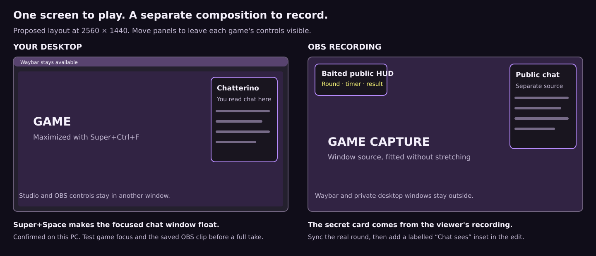

# Baited recording guide: Arch and Hyprland

Prepared 30 October 2026 for separate recordings by `komediruzecki7` and `lakeeko`. Start with one game each and three complete Baited rounds. Use the [three-round runbook](./THREE-CLIPS.md) for conversation prompts and the edit.

This guide supersedes the older 1080p capture recommendation in the YouTube preparation notes. It is a setup plan, not a claim that OBS settings or sources were changed. The current game runs on the [Cloudflare pilot](https://pilot-baited.maff.app/studio); the PC is the game, microphone and recording machine.

## Your PC and the target recording

| Item | Checked on this PC | Recording choice |
| --- | --- | --- |
| Display | Dell S2721DGF, **2560 × 1440**, 165 Hz, scale 1 | Native **2560 × 1440 at 60 fps**. Keep the display at its usual refresh rate. |
| Desktop | Hyprland 0.56.2; Waybar reserves 35 px at the top | Maximize the game while retaining the bar. |
| Recorder | OBS Studio 33.0.0 | Make a dedicated recording profile/scene collection through OBS's UI. |
| Graphics | AMD Radeon RX 9070 family | Prefer hardware H.264 if OBS offers it. Check the actual encoder menu. |
| Capture portal | xdg-desktop-portal-hyprland 1.4.1 | Try individual-window capture through PipeWire. |
| Audio | Focusrite Scarlett 4i4 via PipeWire, 48 kHz | Use the working microphone input and headphones. |

The physical display refresh rate is not the recording frame rate. If the rehearsal shows rendering/encoding lag, reduce the recording to 1440p30 and repeat the test before reducing resolution.

## 1. Arrange the desktop

1. Launch a game that already works on the chosen computer. For a browser game, open it in its own window. Avoid unrelated tabs in that window.
2. Focus the game and press **Super+Ctrl+F**. That is this PC's verified maximize binding. It keeps Waybar available. Initially avoid browser **F11** and exclusive fullscreen, which can change bar visibility and floating-window behavior.
3. Open **Baited Chat**. Select its chat split and use **Ctrl+Alt+N** for the Chatterino overlay. If it tiles beside the game, focus that chat window and press **Super+Space** once to make it float. The owner confirmed this works on this PC. Move/resize it to the upper right, starting around **420 × 520 px**, below Waybar. Leave the game's useful HUD visible. Do not press the toggle again once it is floating.
4. Use **Alt+Tab** to switch windows when needed. Keep Studio and OBS controls on a separate workspace or behind the game. Keep the viewer's live secret-card page off the streamer's desktop.
5. Prefer game-window capture in OBS. Switching to another app then does not deliberately switch the recorded source to that app, but some games pause or stop drawing when unfocused. Check the recording and use a break scene before a longer interruption.

Chatterino connects directly to Twitch. It needs no OBS connection for you to read chat. Its floating desktop position and its position inside the OBS recording are separate.

The Baited OBS HUD is drawn into the recording at the upper left. Adding that source does **not** also put a floating HUD over the game on your desktop. Keep Studio available for round controls. Do not try to play through an OBS projector window.

## 2. Build the OBS scene

In OBS, create a separate scene collection such as **Baited recording** using the menus. Reuse/add the working Baited Browser Source in that collection rather than editing the existing streaming scene blindly. Copy any private OBS URL directly from Studio into source properties; do not put it in this document or a screenshot.

Use these sources, with the top of the Sources list drawn above the others:

| Source | Starting placement on the 2560 × 1440 canvas | How to add it |
| --- | --- | --- |
| Public chat | **x = 2100, y = 40**, about **420 × 520 px** | Add another PipeWire capture and select a dedicated Chatterino chat/overlay window. Crop controls and unused borders. |
| Baited public HUD | **x = 40, y = 40**, roughly **400 px wide** | Existing spoiler-safe Baited Browser Source from the current Studio. Preserve its aspect ratio. |
| Camera, optional | Lower left, clear of the game's UI | Existing camera source if you want a face reaction. Voice alone is enough for the first rehearsal. |
| Game | Fit proportionally within the canvas | **Sources → + → Screen Capture (PipeWire)**, then select the game/browser **Window** in the portal when offered. |
| Background | Entire canvas | Dark Color source to fill any small gaps. |

The portal version installed here implements window capture, but the live chooser, game compatibility and capture-under-focus still need the 30-second check below. Select the game window, not the Studio window. [Versioned portal implementation](https://github.com/hyprwm/xdg-desktop-portal-hyprland/blob/v1.4.1/src/portals/Screencopy.cpp).

For a maximized browser, crop the address/tab controls in OBS if they are included. Fit the remaining picture proportionally. Waybar reduces the desktop work area, and browser controls reduce the game viewport further; do not stretch that smaller picture into 16:9. A small dark border is fine. A browser app window can reduce chrome in a later setup.

For the recorded chat, first try capturing the small Chatterino overlay. If the portal does not list it, capture the regular Chatterino window and crop down to messages. Keep that source window open and check that messages continue updating while the game is focused; an occluded/minimized-window capture can behave differently. Use OBS **Transform → Edit Transform** for a repeatable crop and size.

This captures the real public messages without showing an entire Twitch page. No Chatterino plugin, OAuth token handoff or OBS integration service is needed. A transparent StreamElements Browser Source remains an optional later replacement; its account and widget are not configured by this guide. See [chat setup](../CHAT-SETUP.md).

### If window capture does not work

Use a dedicated desktop/workspace with a monitor capture as the fallback. That includes the visible Chatterino window and Waybar. Crop the bar if desired, avoid adding duplicate chat, and switch OBS to a break scene **before** opening another private window. Recheck with a local recording. Do not describe a monitor capture as isolated game capture.

## 3. Recording settings

Make a separate OBS profile through **Profile → New** or **Duplicate** before changing a working profile. In **Settings → Video**, start with:

- **Base canvas:** 2560 × 1440.
- **Output resolution:** 2560 × 1440.
- **Common FPS:** 60.
- **Color:** SDR/Rec.709; keep the ordinary SDR defaults rather than enabling HDR for this session.

In **Settings → Output → Recording**, use **MKV** and a hardware **H.264** encoder if offered. On this AMD Linux setup, the menu may call it **FFmpeg VAAPI H.264**; availability has not been checked inside OBS. In Simple mode, **Indistinguishable Quality, Large File Size** is a useful starting preset. Record a short test before committing to a long take. OBS recommends MKV because an interrupted recording does not lose the whole file. [OBS recording guide](https://obsproject.com/kb/standard-recording-output-guide).

If hardware encoding is unavailable or fails, first try 30 fps. An Advanced-mode software fallback is **x264, CRF 20, veryfast**, subject to a new game-plus-Moonshine test. It uses CPU capacity that the game and speech model also need. Do not pick NVENC on this AMD-only graphics setup. [OBS encoder baselines](https://obsproject.com/kb/advanced-recording-settings-guide).

Choose a recording folder with space for the session, for example `~/Videos/Baited/2026-10-30/`, and make it through the file picker. At the read-only check, the home filesystem had about 76 GiB available. That can change. Quality-based recordings vary in size; at a constant 24 Mbps, ten minutes of video alone would be about 1.8 GB.

**Local recording and Twitch streaming are separate outputs.** For a rehearsal, use **Start Recording**. To capture the actual live Twitch test, start the Twitch stream when you choose to go live and also start the local recording. Keep the established Twitch stream settings. If you want a 1080p Twitch stream alongside a 1440p local master, use Advanced Output's streaming rescale to 1920 × 1080 and leave recording rescale off, with its own recording encoder. Test that combined load first; this guide has not changed your stream configuration.

## 4. Speech and sound

1. Use headphones and mute the streamer's own Twitch player. Otherwise delayed stream audio can be recorded twice or reach Moonshine through speakers.
2. Select the Focusrite microphone input that already worked in Studio. In OBS, record that microphone once. Avoid having the same mic as both a global input and a second scene source.
3. Set OBS audio to **48 kHz**. Check one spoken sentence and a laugh for clipping. Keep ordinary speech roughly around -18 to -10 dBFS, with louder peaks below -6 dBFS as a starting point. Use the playback test to adjust; these are production targets, not measurements of the current mic.
4. If a single microphone appears on only one side, check **Advanced Audio Properties → Mono** for that mic and listen to the result. Do not downmix every source automatically.
5. Keep game sound below speech. Watch both meters while talking over a noisy game moment. Moonshine should hear your microphone, not a mix of the game, a call or stream playback.
6. Record **track 1 as the complete mix**. If separate sources exist, also keep isolated mic and game/call tracks for editing. Two sounds already combined into Desktop Audio cannot be separated just by assigning that source to two tracks. [OBS multitrack guide](https://obsproject.com/kb/multiple-audio-track-recording-guide).

You and lakeeko are recording separate sessions, so a voice call is optional. If you use one, agree who is allowed to know the word and identify that role in the edit. Do not let the call audio feed back into the streamer's microphone.

## 5. Record the real viewer card separately

The native Twitch Extension's secret card is not baked into OBS's video. Chatterino captures ordinary chat; it does not capture that Extension card.

Have one trusted viewer record their actual Baited Extension while signed into their own allowed testing account. The active streamer must not look at that view during the round. In the iOS Twitch app, the viewer may need **Extensions → Baited → Accept test extension**, as documented in [the pilot guide](../ACTIVE-PILOT.md#viewer-setup-in-the-twitch-ios-app). Start the viewer capture before the round and let it continue through the settled result.

At the beginning of each take, say a marker such as **“Kiko, game one, take one.”** The viewer recording should include the stream audio if possible. It contains two timelines: Twitch video/audio is delayed relative to the local OBS master, while the native Extension card follows live game events. Do not shift the entire viewer file using stream audio and assume the card is aligned too.

For the cropped card inset, use the **matching round number and round-start/result events** as the primary reference against the streamer's public HUD. Show it only during that round's actual interval. If you also use the viewer's delayed Twitch video/audio, sync that region separately to the OBS master using the common spoken marker/audio. File start times and identical-looking countdown digits alone are unreliable.

In the edit, crop the viewer capture into a labelled **Chat sees** card inset. You now have game + public chat + HUD + the real viewer card without a full Twitch-page recording in the final film. Do not add a viewer-authenticated secret source to the streamer's OBS preview. Recording the public HUD first and adding the real viewer view later preserves the role separation.

## 6. The 30-second rehearsal

Before the three rounds:

1. Start a local test recording with the game, Chatterino, Baited HUD and microphone active. Open **View → Stats** in OBS.
2. Have the viewer send a harmless chat message. Speak one sentence over game sound. Switch briefly away and back; check the game and chat captures continue drawing. Do not open a private window during a monitor-capture test.
3. Check the Baited public HUD has current state. Warm Moonshine until ready. Use the opt-in transcript view in Studio to check speech between takes; keep it out of the captured game.
4. Stop and watch both saved test files. In the streamer's clip, confirm readable chat, one copy of your voice, no clipped audio, no wrong/private window and no persistent rendering/encoding lag. In the viewer's file, confirm the actual Extension card is visible and the common stream audio is audible before relying on that capture for synchronization. If needed, lower the game frame cap or recording FPS and test again.
5. Once that passes, record three complete rounds using the [runbook](./THREE-CLIPS.md). Leave at least ten seconds before/after each round. Keep the recording running while results settle.

Chatterino's **Super+Space** floating fix is owner-confirmed. The new OBS composition, encoder and audio mix remain recording-test checks. No recording, stream start, OBS profile change, game installation or upload was performed while preparing this guide.

## 7. Export for YouTube

Keep the original MKV files. In OBS, **File → Remux Recordings** makes an MP4 copy without re-encoding; edit that copy if your editor prefers MP4. Export the edited film at the recorded frame rate with H.264 video, AAC stereo at 48 kHz and SDR Rec.709.

YouTube's SDR upload reference is **24 Mbps for 1440p60**, or **16 Mbps for 1440p30**. These are final-upload reference bitrates, not required recording settings. [YouTube encoding guidance](https://support.google.com/youtube/answer/1722171?hl=en).

Review the final export on the PC and a phone. Cut or zoom to make a clue readable instead of squeezing more tiny interface into one shot. Keep original dialogue, visible time cuts and the real result. Uploading and submitting remain separate actions.

The older YouTube preparation document remains the editorial reference for the three-minute hackathon film. Its historical Node/Express description refers to the PC backend; the current hosted pilot uses **Cloudflare Workers and Durable Objects**, with the React/TypeScript client, Twitch EventSub and local Moonshine speech. Do not narrate the pilot as if Express is hosting it.
